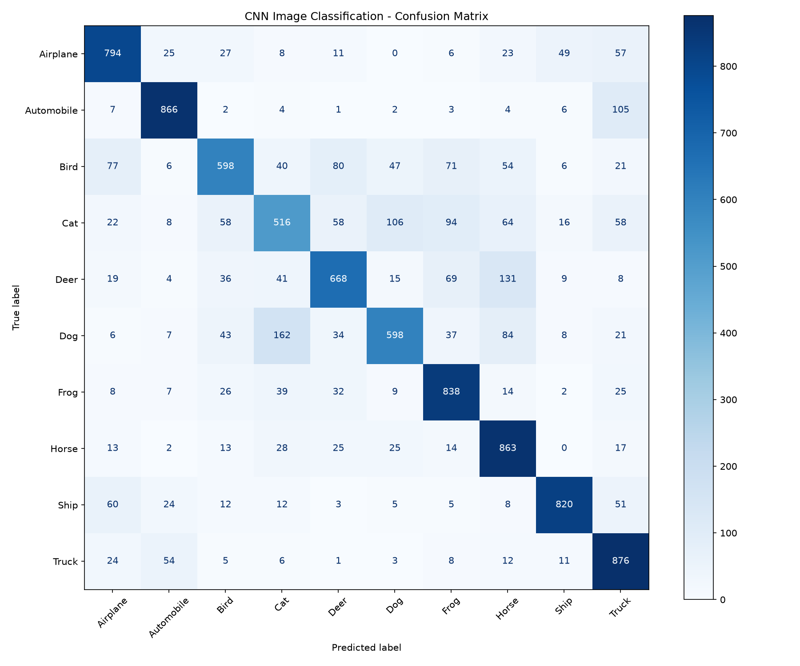
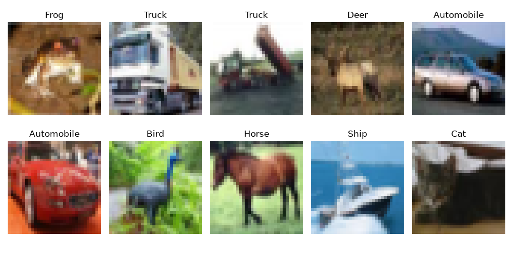

# CNN Image Classification Using TensorFlow and Streamlit

## Project Overview

This project implements a Convolutional Neural Network (CNN) from scratch using TensorFlow and Keras to classify images from the CIFAR-10 dataset.

The model uses convolutional layers, max pooling, data augmentation, dropout regularization, and early stopping to improve image classification performance.

An interactive Streamlit web application allows users to upload images and receive predictions with confidence scores.

## Model Performance

| Metric | Result |
|---|---|
| Dataset | CIFAR-10 |
| Total Images | 60,000 |
| Training Images | 40,000 |
| Validation Images | 10,000 |
| Testing Images | 10,000 |
| Training Epochs | 30 |
| Best Epoch | 25 |
| Test Accuracy | **74.37%** |
| Test Loss | 0.7710 |
| Macro Precision | 0.74 |
| Macro Recall | 0.74 |
| Macro F1-Score | 0.74 |
| Trainable Parameters | 356,810 |

## Technologies Used

- Python 3.11
- TensorFlow and Keras
- NumPy
- Matplotlib
- Scikit-learn
- Pillow
- Streamlit
- Visual Studio Code

## CNN Architecture

The model consists of:

1. Input Layer (32 × 32 × 3)
2. Data Augmentation (Random Flip, Rotation, Zoom)
3. Conv2D (32 filters) + ReLU + MaxPooling
4. Conv2D (64 filters) + ReLU + MaxPooling
5. Conv2D (128 filters) + ReLU + MaxPooling
6. Flatten Layer
7. Dense Layer (128 neurons)
8. Dropout (0.5)
9. Output Layer (10 neurons, Softmax)

The model uses the Adam optimizer and sparse categorical cross-entropy loss.

## Dataset

The CIFAR-10 dataset contains 60,000 RGB images across 10 categories:

Airplane, Automobile, Bird, Cat, Deer, Dog, Frog, Horse, Ship, and Truck.

## Project Structure

```text
CNN-Image-Classification/
├── models/
│   ├── best_cnn.keras
│   └── final_cnn.keras
├── results/
│   ├── classification_report.txt
│   ├── confusion_matrix.png
│   └── prediction.png
├── app.py
├── train.py
├── evaluate.py
├── predict.py
├── requirements.txt
├── sample_images.png
├── .gitignore
└── README.md
```

## Installation

Clone the repository:

```bash
git clone https://github.com/YOUR_USERNAME/CNN-Image-Classification.git
cd CNN-Image-Classification
```

Create a virtual environment:

```bash
py -3.11 -m venv venv
```

Activate it in Windows PowerShell:

```powershell
.\venv\Scripts\Activate.ps1
```

Install dependencies:

```bash
python -m pip install -r requirements.txt
```

## Run the Web Application

```bash
python -m streamlit run app.py
```

Open `http://localhost:8501` in your browser.

Upload a JPG or PNG image and click **Classify Image** to view the prediction.

## Model Evaluation

The model was evaluated using 10,000 test images.

**Test accuracy: 74.37%**

The evaluation includes precision, recall, F1-score, and a confusion matrix.



## Sample Images



## Key Features

- CNN built from scratch using TensorFlow/Keras
- Three convolutional layers with max pooling
- Image augmentation and dropout regularization
- Validation monitoring and early stopping
- Classification report and confusion matrix
- Saved trained model for reuse
- Interactive Streamlit image classification interface

## Future Improvements

- Experiment with batch normalization and deeper CNN architectures
- Improve accuracy through hyperparameter tuning
- Compare results with transfer learning
- Deploy the Streamlit application online

## Conclusion

The CNN achieved **74.37% test accuracy** on CIFAR-10, demonstrating practical image classification using deep learning. The project combines model development, training, evaluation, and an interactive prediction interface.